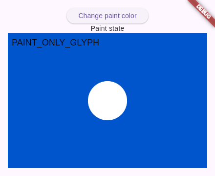
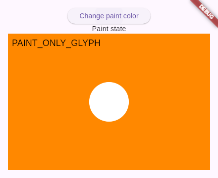

# Compact MCP observation evidence

Recorded 2026-11-17 on Linux x64, Rust 1.93.1, NVIDIA GeForce RTX 5060
(driver 615.78.08), with `VK_LAYER_KHRONOS_validation` enabled. This validates
the adapter over the existing packaged Linux runtime, not a new engine build
or certification of Windows/native desktop behavior.

## Results

All four deterministic task runs passed: form and list/painting, each using
full native snapshots/handles and compact snapshots/refs respectively.

| Measurement | Full semantics | Compact UI |
| --- | ---: | ---: |
| Form observation responses | 132,654 bytes | 10,111 bytes |
| List/painting observation responses | 215,841 bytes | 11,125 bytes |
| Combined observation responses | 348,495 bytes | 21,236 bytes |
| All requests and responses | 514,739 bytes | 195,090 bytes |
| Total requests (including initialization notifications) | 62 | 70 |
| Explicit images | 4 | 4 |

Observation response bytes fell **93.91%**; total request/response wire bytes
fell **62.10%**. These are actual UTF-8 wire sizes, **not measured model-token
savings**. Total traffic includes initialization, the full current tool catalogue,
all actions and waits, negative controls, screenshots (including base64), health,
shutdown and eight extra compact pagination requests. Ordinary observations and
action responses contain no image content or duplicate structured content.

The baseline is the **full semantics path on the same new server**, not the old
server binary or an established screenshot-first workflow. Both runs pay for the
new catalogue (31 tools; canonical catalogue JSON 14,557 bytes). No historical
schema cost was subtracted. Actual model input/output tokens, image-token costs
and agent reasoning/retries were unavailable. These scripted tasks do not
establish an autonomous agent's success rate or total context savings. Startup
includes a build and baseline runs first, so cold-build/cache bias prevents a
latency improvement claim; per-category RPC timings remain in the report.

## Coverage

- Unicode/RTL/emoji form editing, separate dialog view, confirmation and persisted
  value observed through `verify.wait`.
- Actionable refs and native handles; a stale-action negative control after a
  semantics update fails without incrementing the counter a second time.
- A 160-row lazy list: row 30 is initially absent, then appears after three
  supported semantic `scrollDown` actions. Only built semantics are observable;
  scrolling, not a snapshot alone, discovers offscreen content.
- Four 650-character pages per explicit pagination check, with unchanged
  epoch/revision/generation, complete records, and no missing or duplicate refs.
- Text drawn only by `CustomPainter` is absent from semantics. Explicit PNG
  requests retain metadata-before-image and fresh-frame ordering. Unchanged
  control captures decode to identical pixels. Activating the paint button
  changes 62,576 lower-canvas pixels; baseline and compact pixel hashes agree.
- The existing `test_mcp.py` separately passes shutdown/restart and EOF cleanup
  (16 and 11 responses). The 138-test CLI suite includes formatter and adapter
  safety tests; Clippy with warnings denied and Rust formatting pass.

The fixture deliberately uses a reversed list so `scrollDown` is the forward
semantic action; semantic directions describe content motion, not wheel deltas.
Unit tests additionally cover obscured/hidden reads, disabled/state/action
projection, Unicode/long labels, empty/tiny budgets, stale/reused/removed handles,
wrong sessions/views, native identity across adapter-generation restart,
continuations, and explicit screenshot pass-through.

### Visual fallback

These are explicit captures, not automatically attached to snapshot/action calls.
The canvas-only `PAINT_ONLY_GLYPH` text cannot be inspected through semantics.

Before:



After verified activation:



## Reproduce

From `engine/src/flutter/shell/platform/rust`, with Rust 1.93.1:

```sh
RUSTUP_TOOLCHAIN=1.93.1 cargo test --locked --manifest-path rlutter/Cargo.toml
RUSTUP_TOOLCHAIN=1.93.1 cargo clippy --locked --manifest-path rlutter/Cargo.toml --all-targets -- -D warnings
RUSTUP_TOOLCHAIN=1.93.1 cargo fmt --manifest-path rlutter/Cargo.toml -- --check
RUSTUP_TOOLCHAIN=1.93.1 cargo build --locked --manifest-path rlutter/Cargo.toml
```

Use a generated Rust-shell app containing `tests/agent_fixture/lib/main.dart`
and its `flutter_rust_agent` dependency (the same prerequisite as
`tests/test_verify.py`). Supply a compatible Flutter SDK and matching packaged
engine ABI. Paths below are inputs to replace, not committed machine paths:

```sh
RUSTUP_TOOLCHAIN=1.93.1 VK_INSTANCE_LAYERS=VK_LAYER_KHRONOS_validation python3 tests/test_compact_mcp.py \
  --rlutter rlutter/target/debug/rlutter \
  --flutter-root /path/to/compatible/flutter-sdk \
  --project /path/to/generated-agent-fixture \
  --artifacts /path/to/fresh/compact-evidence \
  --timeout 120

RUSTUP_TOOLCHAIN=1.93.1 VK_INSTANCE_LAYERS=VK_LAYER_KHRONOS_validation python3 tests/test_mcp.py \
  --rlutter rlutter/target/debug/rlutter \
  --flutter-root /path/to/compatible/flutter-sdk \
  --project /path/to/fresh/compact-evidence/form-project \
  --artifacts /path/to/fresh/legacy-evidence
```

The comparison copies the generated app independently for each scope and swaps
in `tests/compact_fixture/lib/main.dart` only in the isolated coverage copy.
It does not modify the supplied fixture. It uses `cp --reflink=auto` where
available and a standard-library PNG decoder; no tokenizer or image dependency
is required. Each artifact destination must be fresh. Requests are never
retried automatically; failures are retained and reported as failures.

[report.json](report.json) preserves the successful run's measurements, checks,
pagination, capture ordering metadata and pixel hashes.
[reproduction.json](reproduction.json) records environment, commands, tested
source/binary hashes and legacy results. Machine paths are normalized. Raw
transcripts/logs and the unchanged-control PNG are retained locally under
`agent-artifacts/compact-mcp/run-005`, not bundled here; the script regenerates
these, persisting every exchange before assertions and retaining PNGs separately
while recording image wire cost without repeating base64 in transcripts.

The acceptance criterion for **measured total model-token savings** remains an
external agent evaluation: run the same tasks through a chosen model/client,
charge tool schemas, image tokens, reasoning and retries, and compare task
success across repeated runs before setting a token savings target.
